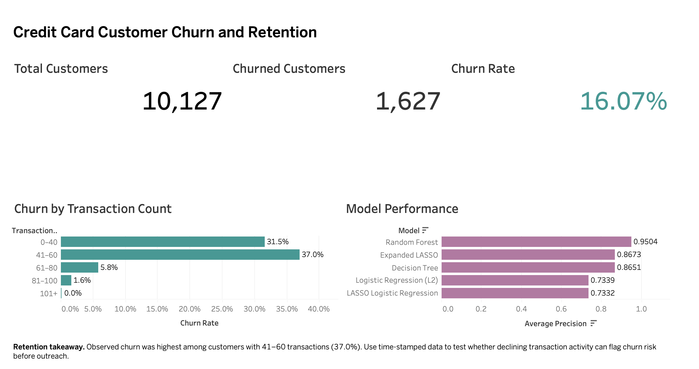

# Credit Card Customer Churn and Retention

I used Python and Tableau to analyse credit card customer churn for my
MSc Business Analytics dissertation. The project examines how recorded
churn varies by transaction activity and what a retention team should
validate before using that information for outreach.

## Key findings

- **1,627 of 10,127 customers** were recorded as having churned (16.07%).
- The **41–60 transaction band** had the highest observed churn rate (37.0%).
- **Random Forest** had the highest average precision (0.9504) among the
  five models on the held-out test set.

## Retention recommendation

Use time-stamped customer data to test whether declining transaction
activity precedes churn. If it does, pilot targeted outreach and compare
retention outcomes against a comparison group. The dataset used here
supports a retrospective analysis of recorded churn.

## Reproduce the analysis

Download `BankChurners.csv`, place it beside the notebook, and run
`credit-card-churn-analysis.ipynb` in Jupyter. The notebook exports the
summary CSVs used to build the Tableau dashboard.

[Dataset source](https://www.kaggle.com/datasets/sakshigoyal7/credit-card-customers)
